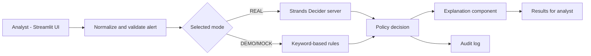

# CyberShield AI: Smart SOC Alert Triage Agent

**Tags:** `#strands-decider-2b` `#policy`

CyberShield AI is a prototype SOC alert-triage application built with Streamlit. Its goal is to classify security alerts into LOW, MEDIUM, or HIGH severity, apply a policy-based response, and provide an analyst with an explanation and safe next steps.

**Current verified status:** The DEMO/MOCK workflow runs locally, and all 12 automated tests passed. The real Strands Decider 2B server and Amazon Bedrock integration have not yet been verified end to end.

The application is designed to keep a human analyst in control. It does not automatically block IP addresses, delete files, or execute system commands.

## Architecture



The REAL path is intended to use Strands Decider 2B for the severity decision. Amazon Bedrock is intended to generate an explanation through Strands Agents. These integrations remain unverified in the current environment.

## How the policy decision works

1. An alert is normalized and validated.
2. The application assigns a severity through the selected mode.
3. A policy maps the severity to a recommended response for the analyst.
4. The result and available explanation are shown in the dashboard.
5. Audit records are written locally when the workflow runs.

The DEMO/MOCK mode uses keyword-based rules. It is useful for demonstrating the interface and workflow, but it is **not a real Decider 2B inference**.

## Features

- Streamlit dashboard for security-alert triage.
- LOW, MEDIUM, and HIGH severity categories.
- Policy-based response recommendations.
- Separate DEMO/MOCK and REAL modes.
- Local audit logging.
- Automated tests for alert handling and workflow behavior.
- Reusable policy-decision code in `cybershield/policy_decision.py`.

## Project structure

```text
cybershield-ai/
├── app.py
├── requirements.txt
├── pytest.ini
├── .env.example
├── .gitignore
├── README.md
├── cybershield/
│   ├── alerts.py
│   ├── explainer.py
│   ├── policy_decision.py
│   └── workflow.py
├── Scripts/
│   ├── probe_decider.py
│   └── bench_decider.py
├── tests/
│   ├── test_alerts.py
│   └── test_workflow.py
└── docs/
    ├── builder_center_article.md
    └── submission_checklist.md
```

## Setup: Windows PowerShell

Run commands from the project directory.

### 1. Create and activate a virtual environment

```powershell
python -m venv .venv
.\.venv\Scripts\Activate.ps1
```

### 2. Install project dependencies

```powershell
python -m pip install --upgrade pip
pip install -r requirements.txt
```

If a package cannot be installed or requires a different Python version, resolve that dependency issue before attempting REAL mode.

### 3. Run the automated tests

```powershell
python -m pytest -q
```

### 4. Start the dashboard

```powershell
python -m streamlit run app.py
```

Select DEMO/MOCK mode to demonstrate the workflow without claiming that a real decision model is running.

## REAL Decider setup

The intended local server command is:

```powershell
strands-decider serve StrandsAgents/strands-decider-2B-qwen3.5-v1-2610 --device cpu --port 8099
```

This command depends on the relevant package, model availability, hardware, and compatible configuration. It has **not** been verified successfully in the current environment. Model downloads and CPU inference may require substantial disk space, memory, and time.

After a compatible server is running, test its response in another terminal:

```powershell
python Scripts/probe_decider.py
```

To measure latency on your own machine after the server is working:

```powershell
python Scripts/bench_decider.py
```

No real-model latency or confidence measurements are claimed in this repository yet.

## Amazon Bedrock

Real Bedrock inference requires AWS credentials, appropriate permissions, model access, and may incur charges. This project has not yet verified a successful Bedrock inference.

Do not commit AWS credentials, access keys, or a real `.env` file. Use an AWS profile or environment variables configured securely. Check AWS pricing and account settings before making requests.

## Modes

- **DEMO/MOCK:** Keyword-based rules for demonstrating the workflow. This is not Decider inference.
- **REAL:** Intended to use the Decider server and configured explanation provider. It must be tested before it can be described as working.

## Reusable policy-decision pattern

The main reusable implementation is `cybershield/policy_decision.py`. It includes the `PolicyQuestion` abstraction and `DeciderServerClient`.

The intended pattern is to define a typed decision question with explicit options, submit a state to the decision service, parse its result, and map the selected option to a policy action.

Verify the implementation and response format against a working server before reusing it in another application.

## Limitations

- REAL mode has not been verified end to end.
- The Decider server was unreachable during the local integration check.
- Amazon Bedrock explanation generation remains unverified.
- All 12 automated tests passed locally, but this does not prove that external model integrations work.
- Policy wording and severity rules have not been validated against real SOC datasets.
- The current test coverage is not a substitute for security evaluation or production testing.
- Local-server authentication and deployment security need further review before any wider deployment.
- Alert text is untrusted input; prompt-injection risks cannot be assumed to be eliminated.
- The prototype is for demonstration and learning, not autonomous incident response.

## Example output format

The following is a format example only, not a real-model result:

```text
Mode: DEMO/MOCK
Source: Keyword-based rules (not Decider)
Severity: MEDIUM
Policy action: Queue for analyst investigation
Explanation status: Template
```

## Security

- Never commit `.env`, AWS keys, private certificates, or local audit logs.
- Review `git status` before committing.
- Keep the application in a local development environment until authentication and deployment controls have been assessed.

## Project status

- [x] Local DEMO/MOCK workflow exercised.
- [x] 12 automated tests passed locally.
- [ ] REAL Decider server verified.
- [ ] Amazon Bedrock inference verified.
- [ ] Public repository and final demo published.
